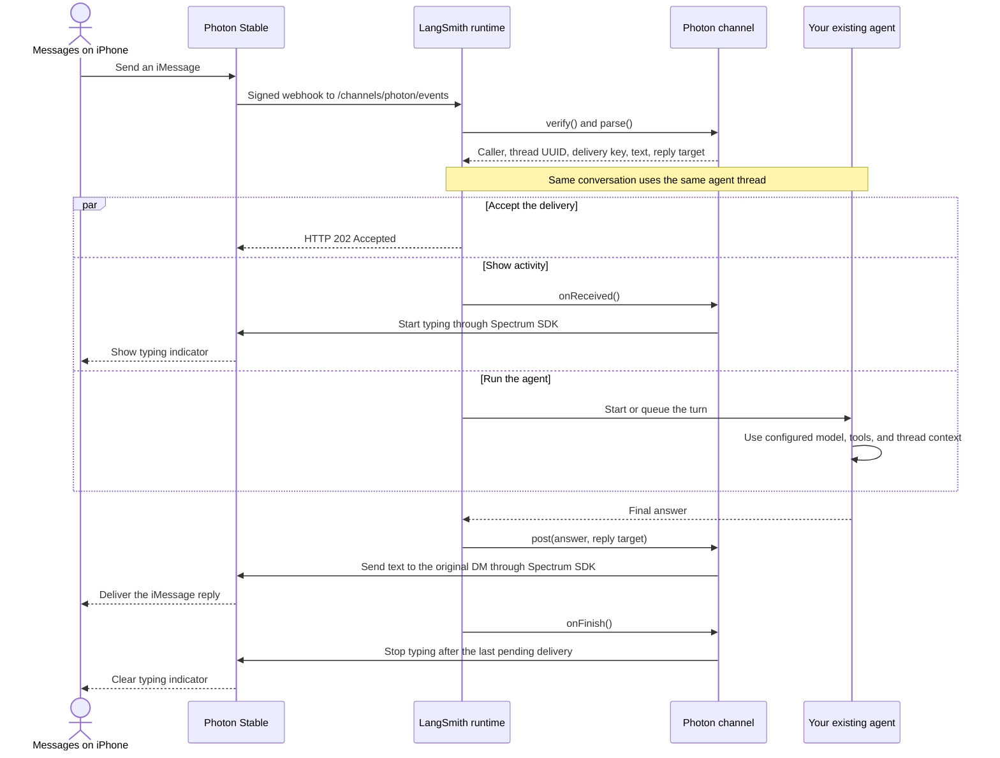

# Photon iMessage channel for LangSmith

Give an existing JavaScript Managed Deep Agent an iMessage line through Photon Stable. LangSmith hosts the channel and runs your agent with its existing model, instructions, and tools.

In your agent project, install `@brianseong99/photon-langchain` and add one file.

```ts
// channels/photon.ts
import { photonImessageChannel } from "@brianseong99/photon-langchain";

export const channel = photonImessageChannel();
```

[Connect a Managed Deep Agent to iMessage](docs/photon-imessage.md) for project setup, deployment, your first message, and troubleshooting. The [example project](examples/managed-agent/) uses the same channel declaration.

## How the channel works

The Photon channel runs inside your LangSmith deployment. It maps each iMessage conversation to a persistent agent thread and sends the final answer back to the original DM.



Typing is best effort and can appear while a turn is queued. The finish hook also clears it after failed or skipped deliveries. [Channel behavior and troubleshooting](docs/photon-imessage.md#use-the-agent-in-messages)

## Develop the package

Use Node.js 24.11+ on the 24.x line, or Node.js 26+. CI uses Node.js 24.

```sh
npm ci
npm run check
npm test
npm run build
npm run smoke
```

The smoke check installs the packed library in a fresh Managed Deep Agents project and compiles that project with `mda build`.
