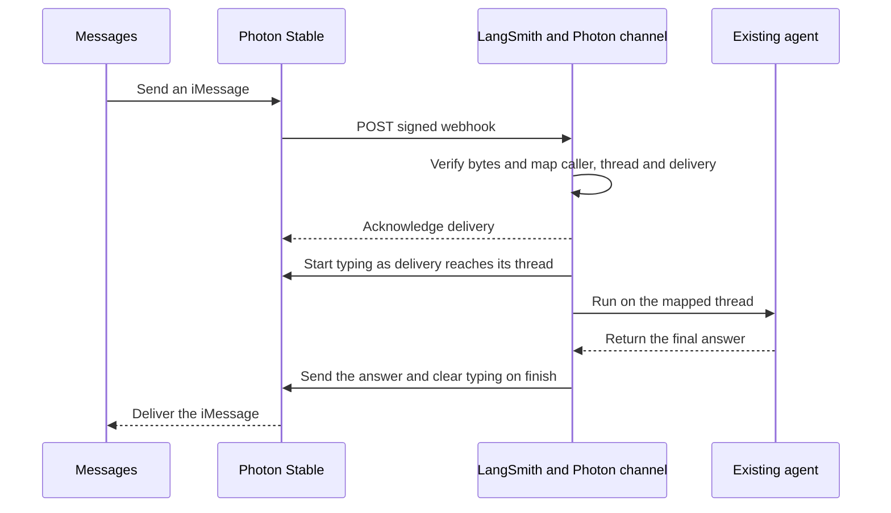

# Connect a Managed Deep Agent to iMessage

Let approved senders text your Photon number and receive replies from your existing agent. Each iMessage conversation maps to one LangSmith thread. The typing indicator can appear while an accepted message waits or the agent runs.

## Prerequisites

- A [JavaScript Managed Deep Agents project](https://docs.langchain.com/langsmith/javascript/managed-deep-agents-quickstart) using `managed-deepagents@0.10.4`, a LangSmith workspace that can deploy it, and credentials for the model your agent already uses.
- A [Photon Stable project](https://photon.codes/docs/spectrum-ts/getting-started) with iMessage enabled. Register your test phone number in the Photon project and note the assigned iMessage number. Photon 2.0 projects use different credentials and APIs.

## Project structure

```text
my-agent/
├── agent.ts
├── instructions.md
└── channels/
    └── photon.ts
```

## Add a Photon channel

Install the adapter in your agent project by package name after publication. To deploy a release candidate, unpack the tarball produced by `npm pack` and install it as a local directory dependency. The Managed Deep Agents build accepts local package directories.

```sh
mkdir -p vendor/photon-langchain
tar -xzf /path/to/brianseong99-photon-langchain-0.1.0.tgz \
  -C vendor/photon-langchain --strip-components 1
npm install ./vendor/photon-langchain
```

Add `channels/photon.ts`. The filename determines the channel name in the webhook URL.

```ts
import { photonImessageChannel } from "@brianseong99/photon-langchain";

export const channel = photonImessageChannel();
```

The sample project pins Managed Deep Agents 0.10.4's transitive `deepagents` package to `1.16.1`. If a fresh install fails with a missing `ModelRefusalError` export, use the same scoped npm override and reinstall.

```sh
npm pkg set overrides.managed-deepagents.deepagents=1.16.1
npm install
```

## Configure the channel

Set these values in your deployment secrets. For CLI-managed deployments, put them in the agent project's ignored `.env` file before deploying. The channel reads them when it handles an event.

| Key | Value |
| --- | --- |
| `PHOTON_PROJECT_ID` | Your Photon Stable project ID. |
| `PHOTON_PROJECT_SECRET` | The outgoing Spectrum SDK credential for that project. |
| `PHOTON_ALLOWED_SENDERS` | A comma-separated list of registered E.164 phone numbers such as `+12025550101`. An empty list accepts no senders. |
| `PHOTON_WEBHOOK_SECRET` | The signing secret Photon returns when you register the webhook. Set it after registration. |

The signing secret authenticates the webhook. The allowlist controls whose signed messages may start runs. An accepted sender is passed to LangSmith as the channel caller.

## Deploy and connect Photon

1. Run `npx mda deploy` from your agent project. Sign in to LangSmith if prompted.
2. In the Photon project, register a webhook for `https://<deployment-url>/channels/photon/events`. Use the deployed agent's URL. Save the signing secret when Photon returns it.
3. Set `PHOTON_WEBHOOK_SECRET` and redeploy with `npx mda deploy`.

[Deploy a Managed Deep Agent](https://docs.langchain.com/langsmith/javascript/managed-deep-agents-deploy) · [Register a Photon webhook](https://photon.codes/docs/webhooks/quickstart)

## Use the agent in Messages

From a registered and allowed phone, text the assigned Photon number. Try “Remember that my favorite color is blue.” Then text “What’s my favorite color?” Both replies should arrive in the same Messages conversation, and the second should say “blue.” With a turn that takes a few seconds, look for the typing dots before the reply. Verify the corresponding runs in LangSmith.



The channel processes inbound plain-text DMs and sends the final text answer. Outbound events, group messages and non-text messages are ignored. LangSmith receives the original Photon message ID as the delivery key. A follow-up has a different delivery key and the same conversation-derived thread ID.

Typing is a best-effort delivery signal. It may appear while a message is waiting for its turn. The finish callback clears it on normal completion, errors, and skipped deliveries. Overlapping deliveries are tracked within each runtime process. A process restart can interrupt cleanup.

## Troubleshoot

| What you see | What to check |
| --- | --- |
| Photon records a `401` | Verify the signing secret, registered URL, deployment revision, and webhook timestamp. |
| Photon records an ignored delivery | Confirm that the sender appears in `PHOTON_ALLOWED_SENDERS`, and that the message is a text iMessage sent directly to the line. |
| LangSmith accepted the event but the agent failed | Open the run in LangSmith and check its model or tool error. |
| The run succeeded but no iMessage arrived | Check the channel delivery error, Photon project credentials, and the line. Confirm delivery in Messages before repeating an uncertain send. |
| The reply arrived without typing dots | Use a slower turn and check the deployment logs for the typing operation. Typing errors leave reply delivery available. |
| The runtime fails to import `ModelRefusalError` | Use the documented `deepagents` npm override for Managed Deep Agents 0.10.4 and reinstall. |
